<div align="center">

  <!-- Interactive Terminal SVG Header -->
  <a href="https://github.com/amannnnnyyyy">
    
  </a>

  <br/>

  <!-- Status Ribbon & Live Action Trigger -->
  <p align="center">
    <code>SYS.LOC: ADDIS ABABA // EAST AFRICA (EAT)</code> &nbsp;•&nbsp; 
    <code>UPTIME: 99.98%</code> &nbsp;•&nbsp; 
    <code>CLEARANCE: LEVEL 5</code> &nbsp;•&nbsp;
    <a href="https://github.com/amannnnnyyyy/amannnnnyyyy/issues/new?template=logbook_entry.yml">
      <b>[⚡ TRANSMIT HANDSHAKE TO LOGBOOK]</b>
    </a>
  </p>

</div>

---

### 🕹️ Interactive Command Deck

> Click the prompt queries below to execute diagnostic scans and explore the subsystems.

<details open>
<summary><b>▸ <code>./amn --diagnostics // Executive Summary &amp; Engineering Focus</code></b></summary>
<br/>

```yaml
Operator: "Amanuel Moha"
Role: "Software Engineer & Machine Learning Practitioner"
Primary_Vectors:
  - "Multilingual Natural Language Processing (Low-Resource Languages & Fine-Tuning)"
  - "Algorithmic Time-Series Forecasting & Quantitative Risk Modeling"
  - "Native Reactive Android Engineering (Jetpack Compose & Kotlin)"
  - "Immersive Web Applications (Three.js 3D & Modern Distributed Stacks)"
Status: "Ready for high-impact technical challenges, research collaborations & engineering roles"
Location: "Addis Ababa, Ethiopia (Open to Remote / Global Relocation)"
```

I build end-to-end intelligent systems that bridge mathematical theory with production-grade engineering. Whether developing custom transformer fine-tuning pipelines for under-represented languages, optimizing time-series neural networks for asset management, or crafting silky 60fps reactive native mobile apps, I focus on system resilience, modularity, and measurable impact.

</details>

<details>
<summary><b>▸ <code>./amn --architecture // Engineering Subsystems &amp; Blueprint</code></b></summary>
<br/>

```
╔════════════════════════════════════════════════════════════════════════════════════════╗
║                              AMN-OS SYSTEM ARCHITECTURE                                ║
╠════════════════════════════════════════════════════════════════════════════════════════╣
║                                                                                        ║
║   [ LAYER 01 // INTELLIGENCE & DATA PLATFORMS ]                                        ║
║   ├── NLP & Transformers      : Hugging Face • XLM-RoBERTa • Custom Tokenization       ║
║   ├── Deep Learning / Math    : PyTorch • TensorFlow • Scikit-Learn • Pandas • NumPy   ║
║   ├── Predictive Analytics    : ARIMA • SARIMA • LSTM • Anomaly & Fraud Classifiers   ║
║   └── Analytical Pipelines    : Automated ETL • Streamlit • Jupyter Labs               ║
║                                                                                        ║
║   [ LAYER 02 // INTERFACE & RUNTIME ENGINES ]                                          ║
║   ├── Native Mobile Core      : Kotlin • Android SDK • Jetpack Compose • Coroutines    ║
║   ├── Web Engineering         : TypeScript • JavaScript • React • Next.js • Tailwind   ║
║   └── Graphics & Spatial      : Three.js • WebGL 3D Pipelines                          ║
║                                                                                        ║
║   [ LAYER 03 // BACKEND & INFRASTRUCTURE CORE ]                                        ║
║   ├── Services & Runtime      : Node.js • Express • Java • Spring Boot • Python APIs   ║
║   ├── Data Stores             : PostgreSQL • MySQL • MongoDB                           ║
║   └── DevOps & Orchestration  : Docker • Git • GitHub Actions CI/CD                    ║
║                                                                                        ║
╚════════════════════════════════════════════════════════════════════════════════════════╝
```

</details>

<details open>
<summary><b>▸ <code>./amn --dossier // Declassified Flagship Projects</code></b></summary>
<br/>

#### 1. 🧠 [EthioMart: Amharic Named Entity Recognition](https://github.com/amannnnnyyyy/Amharic-NER-for-Telegram)
> *High-precision information extraction system for unstructured African e-commerce channels.*
- **Challenge**: E-commerce in Ethiopia operates predominantly through unstructured messaging channels (Telegram), lacking standard schemas.
- **Solution**: Built an end-to-end NLP pipeline that scrapes, ingests, tokenizes, and annotates multi-channel Amharic text, fine-tuning multilingual models (**XLM-RoBERTa**) to extract products, prices, and entity metadata.
- **Tech**: `Python` • `Transformers` • `PyTorch` • `XLM-RoBERTa` • `Data Pipelines`

#### 2. 📈 [Finance Forecast & Portfolio Optimizer](https://github.com/amannnnnyyyy/Finance-Forecast-Portfolio-Optimizer)
> *Quantitative time-series forecasting and capital allocation engine for GMF Investments.*
- **Challenge**: Navigating market volatility through predictive modeling and multi-asset risk optimization.
- **Solution**: Developed a multi-stage time-series suite deploying **ARIMA**, seasonal **SARIMA**, and deep **LSTM** neural networks, integrated with Sharpe ratio maximization and Monte Carlo risk simulations.
- **Tech**: `Python` • `LSTM` • `Time-Series` • `Statistical Modeling` • `Financial Engineering`

#### 3. 🏥 [Ethiopian Medical Business Data Warehouse](https://github.com/amannnnnyyyy/telegram-medical-business-data)
> *Scalable health-sector ETL and analytical data warehouse.*
- **Challenge**: Fragmented medical commercial data distributed across decentralized channels.
- **Solution**: Engineered an automated scraping, deduplication, and transformation pipeline feeding a centralized analytical data warehouse for pharmaceutical trend analysis.
- **Tech**: `Data Warehousing` • `ETL` • `Python` • `Data Engineering`

#### 4. 📱 [Jetpack Compose Native Android Systems](https://github.com/amannnnnyyyy/Simple-Dictionary-App)
> *Modern reactive mobile applications built for performance and intuitive UX.*
- **Highlights**: Built production-quality Android applications using **Kotlin** and **Jetpack Compose** (`Crew` employee manager and `Simple-Dictionary-App`), featuring unidirectional data flow, clean architecture, and reactive states.
- **Tech**: `Kotlin` • `Jetpack Compose` • `Android SDK` • `Coroutines`

#### 5. 🌐 [Interactive 3D Web Engine & Portfolio](https://github.com/amannnnnyyyy/PortfolioWebsite)
> *Spatial web experience combining modern frontend architecture with interactive 3D computing.*
- **Highlights**: Implemented dynamic scene rendering, custom shaders, and lighting controls using **Three.js** and **React** in an optimized responsive pipeline.
- **Tech**: `Three.js` • `React` • `Vite` • `WebGL`

</details>

<details open>
<summary><b>▸ <code>./amn --telemetry // Real-Time GitHub Analytics</code></b></summary>
<br/>

<div align="center">

  <table border="0" cellspacing="0" cellpadding="0">
    <tr>
      <td align="center">
        
      </td>
      <td align="center">
        
      </td>
    </tr>
  </table>

  <br/>

  

</div>

</details>

---

### 📡 AMN-OS Community Neural Logbook

> **Interactive Terminal Feature**: Any visitor can submit a live transmission directly to this profile! Click below to record your handle and message into the active telemetry ledger:
> 
> 👉 **[Click Here to Transmit Handshake to the Logbook](https://github.com/amannnnnyyyy/amannnnnyyyy/issues/new?template=logbook_entry.yml)** 👈

<!-- LOGBOOK:START -->
| Timestamp (UTC) | Node / Visitor | Telemetry Transmission |
| :---: | :---: | :--- |
| `2026-11-14 20:55 UTC` | [@amannnnnyyyy](https://github.com/amannnnnyyyy) | System initialized. AMN-OS neural telemetry active. |
<!-- LOGBOOK:END -->

---

### 📬 Direct Handshake & Transmission

```
┌────────────────────────────────────────────────────────────────────────┐
│  OPERATOR: Amanuel Moha                                                │
│  TRANSMISSION: mohaaman922@gmail.com                                   │
│  NETWORK: github.com/amannnnnyyyy                                      │
│  STATUS: OPEN FOR NEW OPPORTUNITIES & RESEARCH COLLABORATIONS          │
└────────────────────────────────────────────────────────────────────────┘
```

<div align="center">
  <sub>⚡ <i>Powered by AMN-OS Core Daemon // Crafted with precision and clean architecture.</i></sub>
</div>
